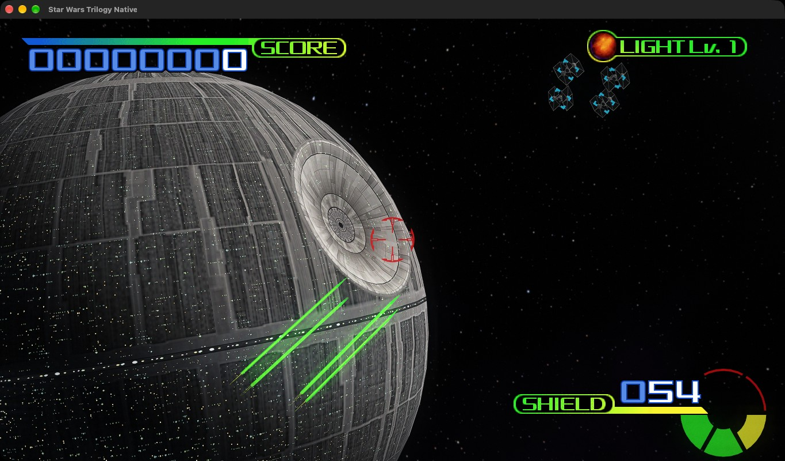

<p align="center">
  
</p>

<p align="center">
  <b>Sega's 1998 arcade game, running natively on PC and Mac.</b><br>
  Not an emulator: the original code, recompiled to C++, with a modern Vulkan renderer.
</p>

## What you get

- **True widescreen** 16:9, not stretched, at any resolution (21:9 too, with `--aspect 21:9`).
- **Ray-traced sun shadows** and ambient occlusion, plus distance haze, bloom, light shafts and
  HDR lighting.
- **New looks, made for this port**:
  - Space redrawn: a deep star field and the Milky Way that turn with the game, and a cinematic grade.
  - The Death Star as in the films: a dark night side, a bright edge on its lit limb and thousands
    of lights in its trenches, which fade into the dark ahead.
  - Lightsabers, laser bolts and explosions light what is around them; lasers and engines glow.
  - Vader's suit and helmet shine and reflect the room; Boba Fett's desert has wind ripples and
    fine sand.
- **Sharp image**: MSAA or NVIDIA DLAA, HD text.
- **Smooth motion** at 120 / 144 Hz and above: the 3D is drawn between the game's own frames.
- **Arcade sound**, the music and voices of the Digital Sound Board included, with surround and headphone modes.
- **Mouse, gamepad (gyro too) or light gun**, with aim assist on a gamepad and the cabinet's force feedback as rumble.
- **Quality presets** (Options > Display > Quality) to set the costly effects at once, from laptops to RTX cards.
- **Achievements and stats** in Records.

<table>
  <tr>
    <td></td>
    <td></td>
  </tr>
  <tr>
    <td></td>
    <td></td>
  </tr>
</table>

## Coming soon

New game modes made for this port, already waiting under **Play > Extra modes**:

- **Dogfight**: your X-wing against squadrons of TIE fighters, with random encounters and
  objectives, so no two flights are the same.

More content will follow in future updates.

## ⚠️ ROM not included

You need your own copy of the arcade ROM. Nothing from it is in this repository.

Look for **`swtrilgy.zip`**, the *Rev. A* set (Sega Model 3 Step 2.1). Inside you should find
files like `epr-21379a.17` and `mpr-21339.01`. Other versions of the game will not work.

It must also contain `epr-21119.ic8`, the program of the joystick's force feedback board. Some older
sets lack it; with one of those the game stops at *FAILED FEEDBACK LEVER INITIALIZE*. `build.bat`
checks every chip of the zip and says which ones are missing.

## Install

You need Windows 10/11 (64-bit) and a GPU with a Vulkan 1.3 driver (most cards and integrated
graphics from 2016 on, with current drivers).

1. Download this repository (green **Code** button > **Download ZIP**) and unzip it.
2. Put `swtrilgy.zip` in the folder.
3. Double-click `install.bat`. It installs what the build needs with winget, Python 3 and the C++
   tools of Build Tools for Visual Studio 2022 (a few GB, accept the Windows prompt), then builds
   the game. It takes a while the first time; you can also drop `swtrilgy.zip` on `install.bat`.
4. Play with `StarWarsTrilogy.exe`.

<details>
<summary>Manual install</summary>

Install [Python 3](https://www.python.org/downloads/) and
[Build Tools for Visual Studio 2022](https://visualstudio.microsoft.com/downloads/#build-tools-for-visual-studio-2022)
with the *Desktop development with C++* workload. The full workload is over 6 GB; the build only
needs the MSVC compiler, CMake and a Windows SDK. In a command prompt:

```
winget install Microsoft.VisualStudio.2022.BuildTools --override "--passive --wait --add Microsoft.VisualStudio.Component.VC.Tools.x86.x64 --add Microsoft.VisualStudio.Component.VC.CMake.Project --add Microsoft.VisualStudio.Component.Windows11SDK.22621"
```

Or in the Visual Studio Installer, choose *Individual components* instead of the workload and
tick *MSVC v143 - VS 2022 C++ x64/x86 build tools (Latest)*, *C++ CMake tools for Windows*
and one *Windows 11 SDK* (it works on Windows 10 too).

Then run `build.bat` with `swtrilgy.zip` next to it (or pass its path: `build.bat D:\roms\swtrilgy.zip`).
It downloads SDL3 and NVIDIA DLSS on the first run.
</details>

### macOS



You need a Mac with Apple silicon, macOS 13 or later and the command line tools (`xcode-select --install`).
Python 3 comes with those tools; CMake and Ninja are used if you have them, else `build_mac.sh` fetches its
own copies into `build/`.

1. Put `swtrilgy.zip` in the folder (or in `roms/`, or pass its path: `./build_mac.sh ~/roms/swtrilgy.zip`).
2. Run `./build_mac.sh`. It downloads SDL3 and MoltenVK (Vulkan on Metal) on the first run and makes
   `Star Wars Trilogy.app` in the folder.
3. Play with `Star Wars Trilogy.app`. It holds all it needs, so you can move it anywhere. That includes the data
   from your ROM, so keep it to yourself. Settings and records are in
   `~/Library/Application Support/Star Wars Trilogy Native` and survive a rebuild.

Compared with Windows: no ray tracing (MoltenVK has no ray queries; the sun shadows and ambient occlusion use
a sharper shadow map and the depth instead), no DLAA (MSAA 8x by default, and **Options > Display > Supersampling**
for smoother still, on a fast Mac), one mouse (a second player uses a gamepad), and UPDATE NOW opens the game's
page instead of updating by itself. Option+Return, Cmd+Return or F11 toggle fullscreen; on most Mac keyboards the
function keys need Fn held.

### Update

Run `update.bat`. It downloads the latest version from GitHub (no git needed), replaces only the
files that changed and rebuilds `StarWarsTrilogy.exe`. Your ROM, settings, records and any
textures of your own are kept; a repository file you edited yourself is copied to
`out\update_backup\` before it is replaced. `update.bat -Check` only says whether there is
something new. In a folder cloned with git it runs `git pull` instead.

The game also checks at launch: when there is news of a new version (`news.txt` on GitHub), the main
menu shows what is new with an **UPDATE NOW** button, which closes the game, runs `update.bat` and
starts the game again once it is rebuilt. Turn it off in OPTIONS > DISPLAY > CHECK FOR UPDATES.

## Controls

| | Mouse and keyboard | Gamepad |
|---|---|---|
| Aim | Move (or the arrow keys) | Sticks, or gyro (turn on GYRO AIM in CONTROLS) |
| Fire (trigger) | Left click or Space | R2 / R1 / A |
| Second trigger | Right click or Ctrl | L2 / L1 / B |
| EVENT button | E or middle click | X |
| Coin + start | 5, then 1 | BACK, then START |
| Pause | Esc | START |

F11 or Alt+Enter toggles fullscreen. C shows an extra crosshair where the mouse points.
Everything else is in **Options**.

By default the sight goes right where the mouse points. **Options > Controls > Mouse / Light gun**
can switch the mouse to move the flight lever instead, as on the cabinet. Light guns that Windows
sees as a mouse (Sinden, Gun4IR and the like) work in the default mode; for a Sinden, keep its
software running for the white border.

## More

- [Other recompiled arcade games](https://github.com/snicolast/LostWorldNative): The Lost World, also
  in the main menu under **More recomps**.
- [How it works](docs/ARCHITECTURE.md): the PowerPC to C++ recompiler and the hardware.

## Support

If you enjoy the port and want to help with the time and tools behind it, you can buy me a coffee.
Entirely optional: it supports the work on this project, not the game, which belongs to Sega.

<a href="https://buymeacoffee.com/snicolast8u"></a>

## License

The code in this repository is under the [MIT License](LICENSE). The libraries and fonts in
`third_party/` keep their own licenses. The gamepad button pictures in `res/pad/` are
[Controller Input Icons](https://opengameart.org/content/controller-input-icons) by ElDuderino (CC0). The game itself (ROM, code, data, music and voices) is
not included and stays the property of its owners: you need your own copy of `swtrilgy.zip`.

<sub>A fan project for personal use, not affiliated with or endorsed by Sega or Lucasfilm.
Star Wars is a trademark of Lucasfilm Ltd.</sub>
